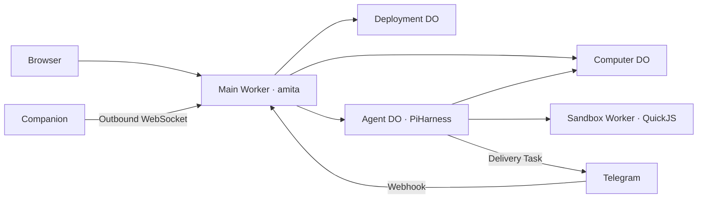

# Architecture and code map

The main Worker serves the web app and API from one origin. Durable Objects (DOs) own application state; a separate Worker hosts QuickJS, and the Companion executes operations on a paired computer.

## Data ownership

| Data                                                                                                            | Owner                                         |
| --------------------------------------------------------------------------------------------------------------- | --------------------------------------------- |
| Login hashes, Agent directory, Computer authorization, channel connections and pairing                          | Deployment DO SQLite; Drizzle migrations      |
| Provider configurations, encrypted API keys, and Telegram Owner binding                                         | Deployment DO synchronous KV                  |
| Agent configuration, session metadata and baseline, Automations, channel destinations and attachment references | Agent DO Pi Documents                         |
| Persona, Memory, and other shared Agent files                                                                   | Agent DO SQLite workspace                     |
| Conversations, Entries, Tasks, committed tool results, and delivery outcomes                                    | Agent DO Pi runtime                           |
| Rebuildable history search index                                                                                | Agent DO SQLite                               |
| Computer connection metadata                                                                                    | Computer DO synchronous KV                    |
| In-flight requests and bounded Bash output                                                                      | Computer DO and Companion process memory      |
| Device credentials, working files, and Bash output files                                                        | Companion state directory and host filesystem |

Each Agent has one DO and PiHarness. A web Session corresponds to a Pi Conversation. Agent and Computer Slugs are stable names used in paths and tools; UUIDs identify server resources. Revoking a Computer keeps its Slug reserved.

AgentDocument owns the Agent model. New sessions copy it into Pi's native session configuration; existing sessions keep their selected model. New-session automation runs capture an explicit model or inherit the Agent model; runs targeting an existing Session use that Session's model. Provider credentials are decrypted server-side for Pi authentication or model discovery using a saved key.

The Agent captures Persona, Memory, and Computer and Skills indexes at session creation and after context compaction. File tools read current contents. Before ordinary model calls, the provider checks that all prompt sections are present. Pi owns prompt rendering and task recovery.

## How a chat request runs

1. Same-origin oRPC authenticates the Owner and forwards input to the Agent.
2. Pi admits the input, calls the model, executes tools, and commits Entries. Input during a run uses Pi's steer mechanism.
3. The browser consumes snapshots and deltas over a hibernatable WebSocket. Native Entries are projected into assistant-ui messages; accepted work continues without the browser.
4. After disconnection, the browser reconnects from its transcript cursor. Failed submissions stay in the composer; a manual retry of unchanged text reuses its operation ID.

Each WebSocket upgrade authenticates and carries the login expiration time. Logout deletes the login and closes the current browser's chat connection. Other existing sockets keep their original expiration; new requests and reconnects authenticate again.

WebSocket packets and history use shared TypeScript contracts backed by Pi types. Public inputs are validated at request boundaries.

A Pi Task generates a title after the first Web or Telegram message; the first message is the display fallback. Generated titles also update linked Telegram Topics. Manual titles take priority. Automations use native Clock and Run Tasks; history is projected from Tasks. [Automation behavior](tools.md#automations) · [Channel behavior](channels.md)

## Computer execution

The Computer DO forwards operations to the authenticated Companion socket. Offline calls fail immediately. File operations finish on their original connection; a running Bash command can resume output delivery on a new connection to the same Companion process.

Pi owns tool intent and committed results. Live remote operations stay in memory; interrupted side effects are reported for inspection. File tools use Pi's native read, write, edit, and path behavior. Writes preserve the existing inode and hard links. [File behavior](tools.md#file-operations)

## Code entry points

| Responsibility                                 | Location                                                                             |
| ---------------------------------------------- | ------------------------------------------------------------------------------------ |
| Worker exports and HTTP/RPC                    | [apps/api](../apps/api), [http](../packages/backend/src/http)                        |
| Directory, authentication, pairing, and schema | [deployment](../packages/backend/src/deployment), [db](../packages/db/src/schema.ts) |
| Agent runtime, sessions, and history           | [agent](../packages/backend/src/agent)                                               |
| Channel routing and Telegram transport         | [channels](../packages/backend/src/channels)                                         |
| Device execution and transfers                 | [computer](../packages/backend/src/computer), [Companion](../apps/companion)         |
| Virtual files and mounts                       | [filesystem](../packages/backend/src/filesystem)                                     |
| Scheduling and run history                     | [automations](../packages/backend/src/automations)                                   |
| QuickJS Worker                                 | [codemode-sandbox](../apps/codemode-sandbox)                                         |
| Web composition and state                      | [Frontend maintenance](frontend.md)                                                  |

`apps/api` is the deployment entry point; `packages/backend` owns business logic. The web client infers oRPC types from the backend's type-only export. Vite builds the browser and both Workers; Go builds the Companion. [Deployment](deployment.md)
